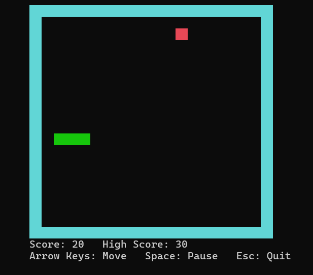

# 🐍 Snake Game — C++

A classic console-based Snake Game built using **C++**, featuring real-time keyboard controls, a colored game board, collision detection, score tracking, and persistent high-score storage.

This project demonstrates core C++ programming concepts and Object-Oriented Programming (OOP) through an interactive game with a menu system, dynamic snake movement, random food generation, and replay functionality.

## 📸 Gameplay



## ✨ Features

- **Interactive Menu:** Start a game, return to the main menu, or quit.
- **Keyboard Controls:** Control the snake using the arrow keys.
- **Dynamic Snake Growth:** Increase the snake's length by collecting food.
- **Random Food Generation:** Spawn food at random positions within the game board.
- **Collision Detection:** Detect collisions with walls and the snake's own body.
- **Pause and Resume:** Pause or resume gameplay using the Spacebar.
- **Score Tracking:** Earn 10 points for every piece of food collected.
- **Persistent High Score:** Save and load the highest score using file handling.
- **Colored Console Interface:** Use different console colors for the snake, food, and walls.
- **Replay Options:** Retry after Game Over or return to the main menu.

## 🛠️ Tech Stack

- **Language:** C++
- **Libraries:** `iostream`, `conio.h`, `windows.h`, `vector`, `string`, `fstream`, `ctime`, `cstdlib`
- **Development Environment:** Visual Studio Code
- **Compiler:** MinGW-w64 / GCC

## 🧠 C++ Concepts Demonstrated

| Concept | Application |
|---|---|
| Classes and Objects | `SnakeGame`, `GameEntity`, and `Food` |
| Inheritance | `Food` inherits from `GameEntity` |
| Polymorphism | Virtual and pure virtual functions |
| Templates | Generic `findMax()` function for comparing scores |
| Operator Overloading | `Point` uses `==` to compare coordinates |
| Structures | `Point` represents X and Y coordinates |
| Vectors | Store the snake's tail coordinates |
| File Handling | Read and save the high score |
| Random Number Generation | Generate food positions |
| Enumerations | Represent movement directions and game scenes |

## 🎮 Controls

| Key | Action |
|---|---|
| ↑ Up Arrow | Move up |
| ↓ Down Arrow | Move down |
| ← Left Arrow | Move left |
| → Right Arrow | Move right |
| Spacebar | Pause / Resume |
| Enter | Select a menu option |
| Esc | Quit the game |

## 🚀 Getting Started

### Prerequisites

- Windows operating system
- A C++ compiler, such as MinGW-w64 with GCC
- A terminal or IDE, such as Visual Studio Code

**Note:** This project uses Windows-specific console APIs through `windows.h` and `conio.h`.

### Installation

**1. Clone the repository**

```bash
git clone https://github.com/Shoheb-rk/Snake-Game.git
```

**2. Navigate to the project directory**

```bash
cd Snake-Game
```

**3. Compile the program**

If your source file is named `main.cpp`, run:

```bash
g++ main.cpp -o SnakeGame
```

**4. Run the game**

```powershell
.\SnakeGame.exe
```

## ⚙️ How It Works

1. **Initialization:** The game initializes its variables, loads the saved high score, and displays the main menu.
2. **Input Handling:** Keyboard input controls menu navigation, snake movement, pausing, and quitting.
3. **Game Logic:** The snake's position and tail coordinates are updated during each game-loop iteration.
4. **Food Collection:** Eating food increases the score by 10 points, grows the snake, and generates a new food position.
5. **Collision Detection:** Hitting a wall or the snake's own body switches the game to the Game Over scene.
6. **Score Persistence:** The highest score is saved to `highscore.txt` when the game object is destroyed.

## 📁 Project Structure

```text
Snake-Game/
├── main.cpp
├── README.md
├── .gitignore
└── highscore.txt
```

`highscore.txt` is used at runtime to store the highest score and may be generated when the game exits.

## 🔮 Future Enhancements

- Add difficulty levels and adjustable game speed.
- Improve rendering to reduce console flickering.
- Improve food placement validation and error handling.
- Introduce graphical rendering using a multimedia library.
- Add unit tests and improve code organization.

## 👨‍💻 Author

**Shoheb Khanadal**

- GitHub: [@Shoheb-rk](https://github.com/Shoheb-rk)

---

*Developed as a C++ project to explore programming fundamentals, game logic, and Object-Oriented Programming.*
